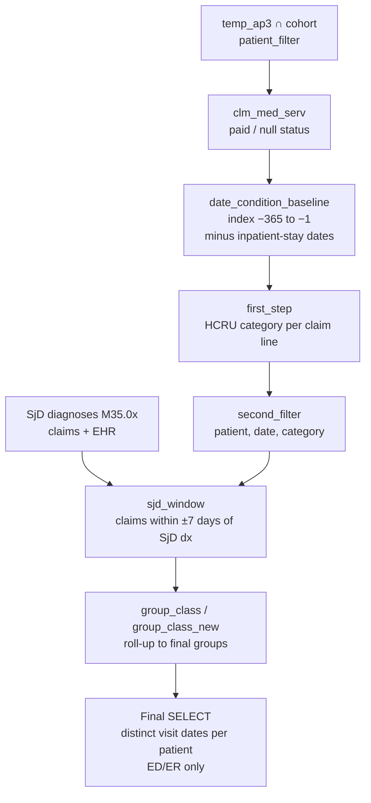

# Healthcare Resource Utilization (HCRU) — Outpatient, ED/ER, OT/PT and Other Visits
 
**Data source:** Optum Market Clarity — Sjögren's / Graves' Disease Cohort
**Schema:** `market_clarity_graves_disease_202505_v1_20250728_prod`
**SQL dialect:** Trino / Presto (e.g., AWS Athena)
**Output grain:** One row per patient × HCRU category
**Companion document:** `README_Cost.md` (cost burden using the same service categories)
 
---
 
## 1. Purpose
 
This query counts **non-inpatient healthcare visits** for each patient in the analytic cohort. It covers outpatient visits, emergency department (ED/ER) visits, occupational/physical therapy (OT/PT), and other services. As configured, it measures:
 
- **Period:** the 365-day **baseline** before the index date (index − 365 to index − 1). A comment in the code notes the dates can be changed to measure look-forward (index to index + 365).
- **Scope:** **SjD-related** services only, defined as claims dated within ±7 days of a Sjögren's disease diagnosis (ICD-10-CM `M35.0x`).
- **Metric:** number of visits, where a visit is a **distinct service date** per patient and category.
- **Output category:** currently **ED/ER** only. The final filter selects a single category per run.
Inpatient care is excluded: all claims dated during an inpatient stay are removed.
 
---
 
## 2. Data Sources
 
### 2.1 Source tables (Optum Market Clarity)
 
| Table | Data type | Fields used |
|---|---|---|
| `argenx_graves_202505_clm_med_serv` | Medical claim service lines | `ptid`, `fst_dt`, `proc_cd`, `tos_cd`, `tos_ext`, `paid_status` |
| `argenx_graves_202505_clm_inp_conf` | Inpatient confinements | `ptid`, `admit_date`, `disch_date` |
| `argenx_graves_202505_clm_med_diag` | Medical claim diagnoses | `ptid`, `diag`, `fst_dt` |
| `argenx_graves_202505_diag` | EHR diagnoses | `ptid`, `diagnosis_cd`, `diag_date` |
 
The schema name indicates a **May 2025 data cut (`202505`), version 1, built 28 July 2025**. *(Inferred from the naming convention — confirm with the data engineering team.)*
 
### 2.2 Upstream dependencies
 
| Object | Role | Required columns |
|---|---|---|
| `step4_flagged_without_sicca` | Analytic cohort from Step 4 of the cohort build, with sicca-flagged patients removed | `ptid` |
| `temp_ap3` | Patient-level index date | `ptid`, `date_of_first_diagnosis` |
 
`date_of_first_diagnosis` is the **index date**.
 
---
 
## 3. Processing Logic
 

 
| Step (CTE) | What it does |
|---|---|
| `patient_filter` | Index dates (`temp_ap3`) for cohort patients only. |
| `clm_med_serv` | Medical service lines with paid or null payment status, for cohort patients. |
| `date_condition_baseline` | Keeps lines dated index − 365 to index − 1, and removes lines on any date that falls inside an inpatient confinement. |
| `first_step` | Assigns each line one HCRU category (Section 5). |
| `second_filter` | Reduces each line to patient, service date, and category. |
| `diagnosis_data_table` | All SjD diagnoses (`M350%`) from claims and EHR, at any date. |
| `sjd_window` | Keeps service dates within ±7 days of any SjD diagnosis. |
| `group_class`, `group_class_new` | Roll the detailed categories up into four final groups (Section 6). |
| Final `SELECT` | Counts distinct service dates per patient for the selected group (currently `ED/ER`). |
 
---
 
## 4. Business Rules
 
**BR-01 — Cohort restriction.** The query includes only patients who are in both `step4_flagged_without_sicca` and `temp_ap3`.
 
**BR-02 — Payment status.** A claim line is kept if `PAID_STATUS` is null or `'P'` (Paid), after trimming and upper-casing.
 
**BR-03 — Baseline window.** Service date (`fst_dt`) from **index − 365 days to index − 1 day**. The index date itself is excluded. For look-forward analysis, the comment in the code says to change the window to index through index + 365.
 
**BR-04 — Inpatient exclusion.** A medical line is removed if its service date matches a date that meets both of these conditions:
- the patient has a **paid** medical claim on that date, and
- the date falls between the admit and discharge dates (inclusive) of any of the patient's inpatient confinements.
This removes all professional and facility services delivered during a hospital stay, so that HCRU reflects outpatient and ambulatory care only.
 
**BR-05 — Category assignment.** Each line receives one category. The rules are checked top-down and the first match wins (Section 5). Procedure-code rules for OT/PT are checked before type-of-service (`tos_cd`) rules.
 
**BR-06 — SjD-related filter.** A service date is kept only if it falls within **7 days before or after any SjD diagnosis** (`M350%`) recorded in medical claims or EHR. The diagnosis can occur at any time.
 
**BR-07 — Visit definition.** A visit is a **distinct service date** per patient and final group. Several claims on the same day in the same group count as one visit.
 
**BR-08 — Output selection.** The final query returns visit counts for one group only (`HCRU_final = 'ED/ER'`). To report another group, change the filter value (Section 7).
 
---
 
## 5. HCRU Category Mapping (Applied in Order)
 
| # | Rule | Category |
|---|---|---|
| 1 | `proc_cd` in the OT/PT code list (below) | OT/PT |
| 2 | `tos_cd` starts with `ANC.DME` | OP - ancillary/radiology |
| 3 | `tos_cd` starts with `ANC.DRUGAD` and `proc_cd` does not start with `A` | OP - drugs administration |
| 4 | `tos_cd` starts with `ANC.HH/HPC` | Home/hospice visit |
| 5 | `tos_cd` starts with `ANC.TRANSP` | OP - ancillary/radiology |
| 6 | `tos_cd` starts with `FAC_OP.ED` or `FAC_OP.ER` | ED/ER |
| 7 | `tos_cd` = `FAC_OP.FO_DIA` | OP - Diagnostic |
| 8 | `tos_cd` = `FAC_OP.FO_LAB` | OP - Lab/pathology |
| 9 | `tos_cd` = `FAC_OP.FO_OTH` and `tos_ext` is a physical-medicine/rehab, chiropractic, osteopathic-manipulation, or wound-therapy sub-type | OP - Physical Medicine/ Rehab |
| 10 | `tos_cd` = `FAC_OP.FO_OTH` and `tos_ext` = infusion therapy (`INFTHR`) | OP - drugs administration |
| 11 | `tos_cd` = `FAC_OP.FO_OTH` and `tos_ext` = established patient, new patient, or clinic | OP - Physician office visit |
| 12 | Any other `FAC_OP.FO_OTH` | OP - Facility Others |
| 13 | `tos_cd` = `FAC_OP.FO_RAD` | OP - ancillary/radiology |
| 14 | `tos_cd` = `FAC_OP.FO_SUR` | OP - Surgery |
| 15 | `tos_cd` = `PROF.ALLERG`, `PROF.ANESTH`, `PROF.CELTHR`, `PROF.DENPRO`, `PROF.MH`, `PROF.PROOTH`, `PROF.PRVMED`, `PROF.VSHRSP` | OP - other professional services |
| 16 | `tos_cd` = `PROF.CONSUL` or `PROF.CONSUL.O` | OP - Physician office visit |
| 17 | `tos_cd` starts with `PROF.DIAGTS` | OP - Diagnostic |
| 18 | `tos_cd` starts with `PROF.ED` or `PROF.ER` | ED/ER |
| 19 | `tos_cd` starts with `PROF.IMMINJ` and `proc_cd` does not start with `A` | OP - drugs administration |
| 20 | `tos_cd` starts with `PROF.LAB` or `PROF.PATHOL` | OP - Lab/pathology |
| 21 | `tos_cd` = `PROF.OBSTET` | Obstetrics |
| 22 | `tos_cd` starts with `PROF.OFFVIS` | OP - Physician office visit |
| 23 | `tos_cd` starts with `PROF.PHYMED` | OP - Physical Medicine/ Rehab |
| 24 | `tos_cd` starts with `PROF.RAD` | OP - ancillary/radiology |
| 25 | `tos_cd` starts with `PROF.SURG` | OP - Surgery |
| — | Anything else (including the `ANC.DRUGAD`/`PROF.IMMINJ` lines excluded by the `A`-code rule) | Others |
 
**OT/PT procedure codes (CPT/HCPCS)** fall into these groups:
 
| Group | Codes |
|---|---|
| Chiropractic manipulation | 98940–98943 |
| Casting and strapping | 29065–29799 (selected) |
| Biofeedback | 90901, 90912, 90913 |
| Balance, range-of-motion, and vestibular tests | 92548, 95851, 95852, 95992 |
| Physical medicine modalities and procedures | 97010–97039, 97110–97150 |
| PT/OT evaluations | 97161–97168 |
| Therapeutic activities and training | 97530–97552 |
| Wound care | 97597–97606 |
| Tests and measurements, orthotics/prosthetics | 97750–97799 |
| Speech therapy | 92507 |
| Developmental and neuropsychological testing | 96110, 96112, 96113, 96125, 96127 |
| Health behavior assessment/intervention | 96156–96171 |
| Remote therapeutic monitoring | 98975–98981 |
| Electrical stimulation | G0283 |
| Low-level laser | 0552T |
 
---
 
## 6. Final Reporting Groups
 
| Detailed category | Final group (`HCRU_final`) |
|---|---|
| Any category starting with `OP` (office visit, diagnostic, lab, radiology/ancillary, surgery, drug administration, physical medicine/rehab, facility others, other professional) | OP Visit |
| ED/ER | ED/ER |
| OT/PT | OT/PT |
| Others, Home/hospice visit, Obstetrics | OTHER_FINAL |
 
---
 
## 7. Output Specification
 
| Column | Description |
|---|---|
| `ptid` | Optum de-identified patient ID |
| `HCRU_final` | Final reporting group (currently always `ED/ER`) |
| `no_of_visits_baseline` | Number of distinct service dates in that group during the baseline window |
 
To produce all groups in one run, remove the `where HCRU_final = 'ED/ER'` filter. To include patients with no visits, left-join the result to the cohort and set missing counts to 0.
 
---
 
## 8. Assumptions, Limitations, and Points for Review
 
Items marked **Action** should be resolved before results are shared.
 
**1. Header line.** The first line begins with an em dash (`—---`), so it is not a valid SQL comment and the query will fail. **Action:** replace it with `--`.
 
**2. The baseline SjD filter may cover only the last week before index.** If `date_of_first_diagnosis` is the patient's first SjD diagnosis, there can be no SjD diagnosis earlier in the baseline. The ±7-day window then captures only services from index − 7 to index − 1. **Action:** confirm how the index date is defined, and whether baseline HCRU should be all-cause instead.
 
**3. EHR diagnosis codes may not match.** The SjD diagnosis filter uses `LIKE 'M350%'` without removing dots or upper-casing. The other scripts strip dots first. EHR codes stored as `M35.0x` would therefore be missed. **Action:** apply `UPPER(REPLACE(code, '.', ''))` before matching.
 
**4. "OP Visit" means any outpatient service day.** The OP Visit group includes labs, radiology, diagnostics, drug administration, and surgery, not only physician encounters. A day with only a lab draw counts as one OP visit. **Action:** confirm this definition, or report office visits separately.
 
**5. Patients with zero visits are not in the output.** Use a cohort left join (Section 7) before calculating means or percentages.
 
**6. No enrollment check in this script.** Baseline counts assume the patient was observable throughout the 365 days before index. **Action:** confirm that continuous enrollment is required upstream.
 
**7. Inpatient exclusion has a payment-status gap.** The exclusion step looks only for `PAID_STATUS = 'P'`, but the main filter also keeps null-status claims. A null-status line on an inpatient date is kept unless a paid claim exists on the same date.
 
**8. Some code groupings may need review.**
- The OT/PT list includes developmental, neuropsychological, and health-behavior codes (96110–96171) and remote monitoring codes (98975–98981), which are not strictly OT/PT.
- DME (`ANC.DME`) and transportation (`ANC.TRANSP`) are classified as "ancillary/radiology".
- **Action:** confirm with the study team.
**9. A-code drug administration lines fall into Others.** Drug-administration lines with HCPCS `A` codes (supplies) are not dropped. They fall through to "Others" and so count toward `OTHER_FINAL`.
 
**10. Inline code lists.** The OT/PT and `tos_ext` lists are hard-coded and are repeated in the companion cost script. Edits in one place must be copied to the other.
 
---
 
## 9. Suggested Quality Checks
 
1. Run without the final category filter. Compare the distribution of visits across the four groups with expectations.
2. Check how many claim lines and patients the inpatient exclusion removes.
3. Check how many lines the ±7-day SjD filter removes (Section 8, item 2).
4. Calculate mean and median visits per patient per group, including patients with zero visits.
5. Spot-check a few patients to confirm that the same-day facility and professional claims for an ED visit count as one visit.
---
 
## 10. Glossary
 
| Term | Definition |
|---|---|
| HCRU | Healthcare resource utilization |
| TOS / `tos_cd` | Optum type-of-service code (e.g., `FAC_OP` facility outpatient, `PROF` professional, `ANC` ancillary) |
| `tos_ext` | Extended, more detailed type-of-service code |
| OT/PT | Occupational and physical therapy (plus related rehab services in this script) |
| Visit | Distinct service date per patient and category |
| Baseline | 365 days before the index date |
 
---
 
## 11. Document Control
 
| Field | Value |
|---|---|
| Owner | *TBD* |
| Reviewer | *TBD* |
| Data cut | May 2025 (`202505`), v1, built 2025-07-28 |
| Last updated | *TBD* |
 
